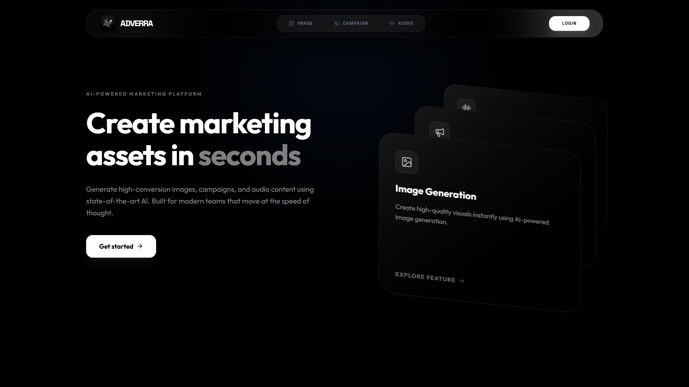
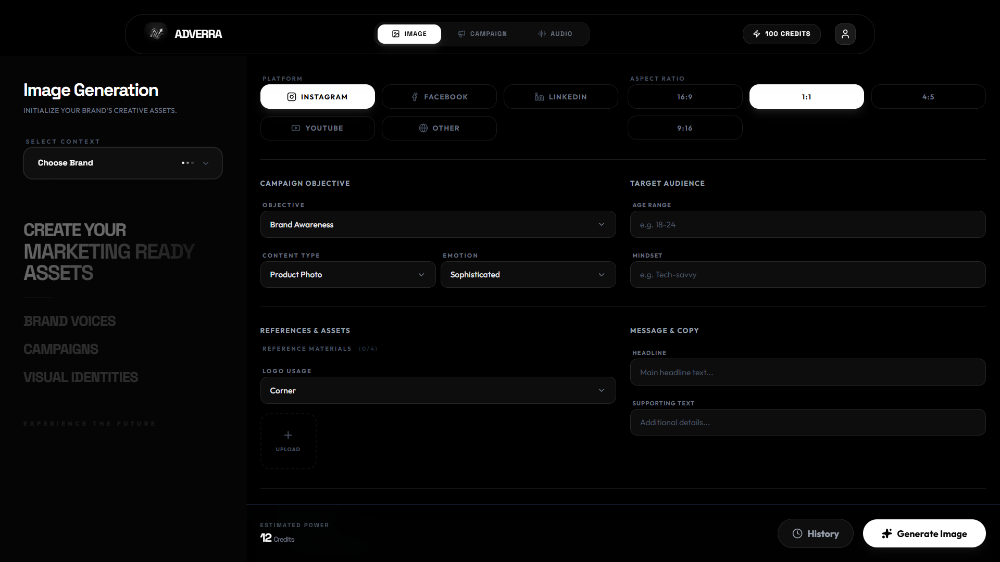
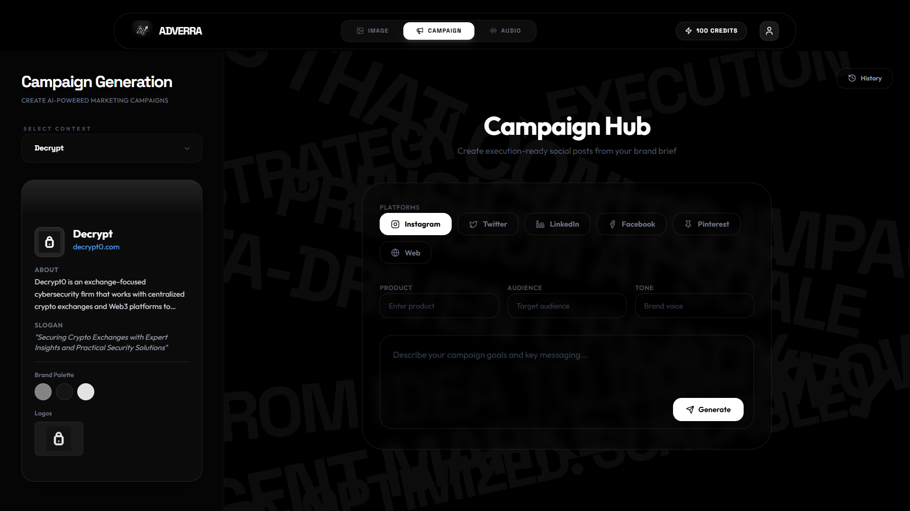
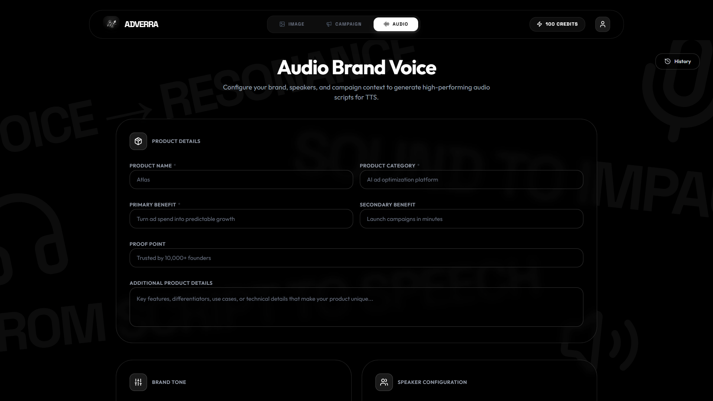
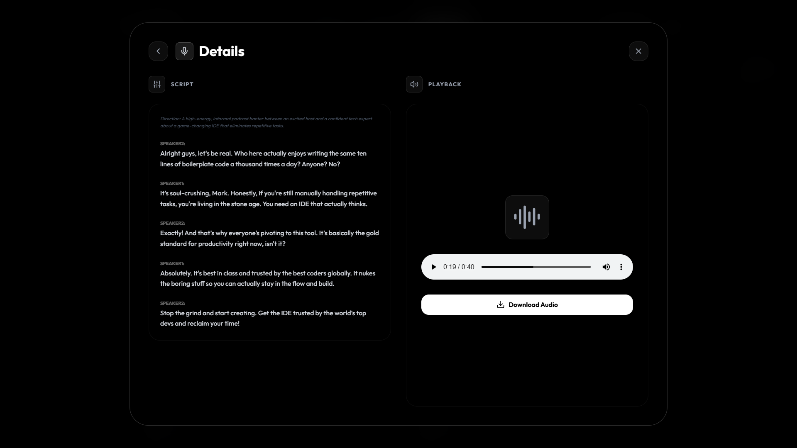

<p align="center">
  
</p>

<h1 align="center">Adverra</h1>

<p align="center">
  <strong>AI-Powered Marketing Asset Generation Platform</strong><br/>
  Create stunning images, audio ads, and campaign copy — all driven by your brand identity.
</p>

<p align="center">
  
  
  
  
  
  
</p>

---

## Table of Contents

- [Overview](#overview)
- [Features](#features)
- [Screenshots](#screenshots)
- [Architecture](#architecture)
- [Tech Stack](#tech-stack)
- [Getting Started](#getting-started)
- [Environment Variables](#environment-variables)
- [Project Structure](#project-structure)
- [API Reference](#api-reference)
- [Database Schema](#database-schema)
- [AI & Prompt Engineering](#ai--prompt-engineering)
- [Design System](#design-system)
- [Key Design Decisions](#key-design-decisions)
- [License](#license)

---

## Overview

**Adverra** is a full-stack, AI-powered creative platform that enables marketers, brand managers, and content creators to generate production-ready marketing assets from a single unified workspace. It combines multi-modal AI generation (images, audio, text) with a brand-aware workflow — meaning every piece of content you create is informed by your brand's identity, voice, and visual language.

> One platform. Every asset type. Always on-brand.

---

## Features

### Brand Intelligence

- **One-Click Brand Extraction** — Enter any domain and Adverra pulls logos, brand colors, description, slogan, and social presence via Brand.dev API
- **Brand-First Workflow** — Every generation tool uses your selected brand profile as creative context
- **Multi-Brand Management** — Maintain and switch between multiple brand profiles

### AI Image Generation

- Platform-aware targeting (Instagram, Facebook, LinkedIn, YouTube)
- Multiple aspect ratios (16:9, 1:1, 4:5, 9:16)
- 6 curated visual tone styles: Claymorphism, Retro Cel-Shaded, Cyber Organic, Hand Drawn, 3D, Hyper Realistic
- Reference image uploads for visual inspiration (up to 4)
- Logo integration with placement control
- Layout frameworks: Minimal, Editorial, Infographic, Cinematic
- Full generation history with download

### Campaign Copy Generation

- Multi-platform support (Instagram, Twitter, LinkedIn, Facebook, Pinterest, Web)
- Platform-specific tone, hashtag count, CTA styles, and posting time recommendations
- Structured AI output: ready-to-post caption, audience analysis, hashtags, and scheduling suggestions
- Zero meta-commentary — the output is immediately publishable

### Audio Ad Generation (Advanced TTS)

- Two-phase AI pipeline: Script generation → Audio synthesis
- Single or multi-speaker dialogue modes
- 10 prebuilt AI voices with distinct personalities
- 5-axis brand tone control (Formality, Energy, Emotion, Humor, Authority)
- Audience-aware context: listening environment, pain points, roles
- WAV output with in-browser playback and download

### Authentication & Security

- Supabase Auth with email/password
- JWT-based session flow with automatic token refresh
- Protected routes with redirect for unauthenticated access
- Server-side token validation on every API request

---

## Screenshots

### AI Image Generation Studio

<p align="center">
  
</p>

The image generation workspace features a brand sidebar for instant context switching, platform targeting selectors, visual tone grids with preview thumbnails, reference image uploaders, and a comprehensive set of creative controls — all wrapped in a premium dark-mode glass-morphism UI.

---

### Campaign Copy Generator

<p align="center">
  
</p>

The campaign module lets you select a target platform, define your product and audience context, set tone preferences, and generate publish-ready social media copy complete with hashtags, audience insights, and optimal posting times.

---

### Audio Ad Studio

<p align="center">
  
</p>

The audio generation flow captures product details, brand tone personality (via 5-axis sliders), speaker configuration, audience context, and campaign settings to produce a structured ad script.

---

<p align="center">
  
</p>

Once generated, the audio page provides full script visualization with direction lines and speaker labels, plus an in-browser WAV player with download capability and complete generation history.

---

## Architecture

```
┌──────────────────────────────────────────────────────────────────────┐
│                        FRONTEND (React 19 / Vite 6)                  │
│                                                                      │
│  Pages: Landing │ Image │ Campaign │ Audio │ Login │ Signup          │
│  State: Zustand (useImageGenerationStore, useDataStore)              │
│  Auth: Supabase client-side session (AuthContext)                    │
│  API: Axios instance with JWT Bearer interceptor                     │
│  UI: Tailwind CSS 4 + Glass-morphism + GSAP animations              │
└───────────────────────────────┬──────────────────────────────────────┘
                                │ HTTPS + Bearer JWT
                                ▼
┌──────────────────────────────────────────────────────────────────────┐
│                      BACKEND (Node.js + Express 4.18)                │
│                                                                      │
│  Middleware: authenticateUser (Supabase JWT validation)               │
│  Routes: /api/auth │ /api/brands │ /api/assets │ /api/audio │        │
│          /api/campaigns                                              │
│  Controllers: auth │ brand │ asset │ audio │ campaign                │
│  Utils: Prompt engineering modules, retry logic, image pipelines     │
└──────┬──────────────┬───────────────┬──────────────┬─────────────────┘
       │              │               │              │
       ▼              ▼               ▼              ▼
   Supabase       Gemini AI       Cloudinary     Brand.dev
   (Auth/DB/      (Image/Text/    (Image CDN/    (Brand
    Storage)       TTS/Script)     Transforms)    Extraction)
```

**Data Flow:**
1. User authenticates via Supabase → JWT issued
2. Frontend attaches JWT to all API requests via Axios interceptor
3. Backend validates token, processes request, orchestrates AI generation
4. Generated assets stored in Cloudinary (images) or Supabase Storage (audio)
5. Metadata persisted in Supabase PostgreSQL
6. Frontend displays results with history browsing and download

---

## Tech Stack

### Frontend

| Technology | Version | Purpose |
|---|---|---|
| React | 19 | UI framework with hooks-first architecture |
| Vite | 6 | Lightning-fast build tool & HMR dev server |
| React Router | 7 | Client-side SPA routing |
| Zustand | 5 | Lightweight, hook-based state management |
| Tailwind CSS | 4 | Utility-first styling via `@tailwindcss/vite` plugin |
| GSAP | 3.14 | High-performance animations (CardSwap hero) |
| Lucide React | 0.563 | Consistent icon system |
| Axios | 1.13 | HTTP client with request/response interceptors |
| Supabase JS | 2.95 | Client-side auth session management |

### Backend

| Technology | Version | Purpose |
|---|---|---|
| Node.js + Express | 4.18 | RESTful API server |
| Google GenAI SDK | 1.38 | Gemini AI (image, text, TTS, script) |
| Supabase JS | 2.39 | Auth verification, PostgreSQL, file storage |
| Cloudinary | 1.41 | Image upload, optimization, CDN delivery |
| Multer | 2.0 | Multipart file upload handling |
| Axios | 1.6 | External API calls (Brand.dev) |
| JSZip | 3.10 | Asset bundling utilities |

### External Services

| Service | Role |
|---|---|
| **Supabase** | Authentication (JWT), PostgreSQL database, WAV file storage |
| **Google Gemini AI** | Image gen (`gemini-3-pro-image-preview`), Campaign gen (`gemini-2.5-flash`), Script gen (`gemini-3-flash-preview`), TTS (`gemini-2.5-flash-preview-tts`) |
| **Cloudinary** | Image hosting, auto-format, quality transforms, CDN delivery |
| **Brand.dev** | Automated brand identity extraction from domain URLs |

---

## Getting Started

### Prerequisites

- **Node.js** ≥ 18.x
- **npm** ≥ 9.x
- Accounts on: [Supabase](https://supabase.com), [Google AI Studio](https://aistudio.google.com), [Cloudinary](https://cloudinary.com), [Brand.dev](https://brand.dev)

### Installation

```bash
# Clone the repository
git clone https://github.com/your-username/adverra.git
cd adverra

# Install backend dependencies
cd backend
npm install

# Install frontend dependencies
cd ../frontend
npm install
```

### Running the Development Servers

**Backend** (runs on `http://localhost:3001`):

```bash
cd backend
npm run dev
```

**Frontend** (runs on `http://localhost:5173`):

```bash
cd frontend
npm run dev
```

### Production Build

```bash
cd frontend
npm run build
npm run preview   # Preview the production build locally
```

---

## Environment Variables

### Backend (`backend/.env`)

```env
PORT=3001
SUPABASE_URL=your_supabase_project_url
SUPABASE_ANON_KEY=your_supabase_anon_key
GEMINI_API_KEY=your_google_ai_api_key
CLOUDINARY_CLOUD_NAME=your_cloudinary_cloud_name
CLOUDINARY_API_KEY=your_cloudinary_api_key
CLOUDINARY_API_SECRET=your_cloudinary_api_secret
BRAND_DEV_API_KEY=your_brand_dev_api_key
```

### Frontend (`frontend/.env`)

```env
VITE_SUPABASE_URL=your_supabase_project_url
VITE_SUPABASE_KEY=your_supabase_anon_key
VITE_BACKEND_URL=http://localhost:3001
```

---

## Project Structure

```
adverra/
├── frontend/
│   ├── public/
│   │   └── ui-img/              # UI screenshots & assets
│   ├── src/
│   │   ├── components/
│   │   │   ├── brand/           # BrandCard, BrandModal, BrandSidebar
│   │   │   ├── common/          # Shared UI components
│   │   │   ├── CardSwap.jsx     # GSAP-animated landing hero
│   │   │   ├── ImageUpload.jsx  # Reference image uploader
│   │   │   └── Navbar.jsx       # Top + mobile bottom navigation
│   │   ├── context/
│   │   │   └── AuthContext.jsx  # Supabase auth provider
│   │   ├── libs/
│   │   │   ├── api.js           # Axios instance with JWT interceptor
│   │   │   └── supabaseClient.js
│   │   ├── pages/
│   │   │   ├── AudioPage.jsx
│   │   │   ├── CampaignGeneration.jsx
│   │   │   ├── ImageGeneration.jsx
│   │   │   ├── LandingPage.jsx
│   │   │   ├── Login.jsx
│   │   │   └── Signup.jsx
│   │   ├── store/
│   │   │   ├── useDataStore.js
│   │   │   └── useImageGenerationStore.js
│   │   ├── App.jsx
│   │   └── main.jsx
│   ├── package.json
│   └── vite.config.js
│
├── backend/
│   ├── config/
│   │   ├── cloudinary.js        # Cloudinary SDK setup
│   │   ├── gemini.js            # Google GenAI client init
│   │   └── supabase.js          # Supabase admin client
│   ├── controllers/
│   │   ├── asset.controller.js  # Image generation pipeline
│   │   ├── audio.controller.js  # Script gen + TTS pipeline
│   │   ├── auth.controller.js   # Signup/login/session
│   │   ├── brand.controller.js  # Brand extraction + CRUD
│   │   └── campaign.controller.js # Campaign copy generation
│   ├── middleware/
│   │   └── auth.js              # JWT validation middleware
│   ├── routes/
│   │   ├── asset.route.js
│   │   ├── audio.route.js
│   │   ├── auth.route.js
│   │   ├── brand.route.js
│   │   └── campaign.route.js
│   ├── utils/
│   │   ├── assets.prompts.js    # Visual tone system instructions
│   │   ├── imageUserPrompt.js   # Dynamic prompt builder
│   │   ├── platformImageRules.js # Platform-specific image rules
│   │   ├── platformRules.js     # Platform-specific text rules
│   │   ├── prompts.js           # Campaign & audio prompts
│   │   ├── retry.js             # API retry logic
│   │   ├── uploadImage.js       # Cloudinary upload utility
│   │   └── uploadUrlImageToGemini.js # Gemini File API upload
│   ├── server.js                # Express app entry point
│   └── package.json
│
├── context.md                   # Project documentation
└── README.md                    # You are here
```

---

## API Reference

### Authentication

| Method | Endpoint | Auth | Description |
|---|---|---|---|
| `POST` | `/api/auth/signup` | — | Create account (email + password) |
| `POST` | `/api/auth/login` | — | Sign in, returns session token |
| `GET` | `/api/auth/check` | — | Verify active session |

### Brands

| Method | Endpoint | Auth | Description |
|---|---|---|---|
| `POST` | `/api/brands/extract` | — | Extract brand identity from a domain URL |
| `POST` | `/api/brands` | Partial | Save brand profile |
| `GET` | `/api/brands` | Partial | List all user brand profiles |

### Assets (Image Generation)

| Method | Endpoint | Auth | Description |
|---|---|---|---|
| `POST` | `/api/assets/generate` | ✅ | Generate AI image (full pipeline) |
| `POST` | `/api/assets/upload-reference` | ✅ | Upload reference image to Gemini File API |
| `GET` | `/api/assets` | ✅ | Retrieve image generation history |

### Audio

| Method | Endpoint | Auth | Description |
|---|---|---|---|
| `POST` | `/api/audio` | ✅ | Generate audio ad (script + TTS synthesis) |
| `GET` | `/api/audio` | ✅ | Retrieve audio generation history |

### Campaigns

| Method | Endpoint | Auth | Description |
|---|---|---|---|
| `POST` | `/api/campaigns` | ✅ | Generate platform-specific campaign copy |
| `GET` | `/api/campaigns` | ✅ | Retrieve campaign history |

---

## Database Schema

### Supabase PostgreSQL

#### `brand_data`
```sql
id          INT          PRIMARY KEY
brand       JSONB        -- { title, description, logos[], colors[], slogan, backdrops, domain }
userId      UUID         -- Owner reference (Supabase Auth UID)
created_at  TIMESTAMPTZ  -- Auto-generated
```

#### `brand_assets`
```sql
id            INT          PRIMARY KEY
userId        UUID         -- Owner reference
img_url       TEXT         -- Cloudinary secure URL
img_meta_data JSONB        -- { publicId, width, height, format }
created_at    TIMESTAMPTZ
```

#### `brand_audio`
```sql
id          INT          PRIMARY KEY
filename    TEXT         -- Generated WAV filename
publicUrl   TEXT         -- Supabase Storage public URL
userId      UUID         -- Owner reference
script      JSONB        -- { direction_line, mode, script_lines[] }
context     JSONB        -- Original form submission data
created_at  TIMESTAMPTZ
```

#### `brand_campaigns`
```sql
id          INT          PRIMARY KEY
userId      UUID         -- Owner reference
campaign    JSONB        -- { title, actualCampaign, targetAudience, hashtags[], bestTimeToPost }
created_at  TIMESTAMPTZ
```

### Supabase Storage

| Bucket | Path Pattern | Content |
|---|---|---|
| `brand_audio` | `audio/ads/{filename}-{timestamp}.wav` | Generated audio ad WAV files |

---

## AI & Prompt Engineering

Adverra uses a sophisticated **layered prompt architecture** for image generation:

```
┌─────────────────────────────────────────────┐
│  Layer 1: System Instructions (Art Style)   │
│  ~500+ words per style defining rendering   │
│  rules, palettes, composition, quality      │
├─────────────────────────────────────────────┤
│  Layer 2: User Prompt (Dynamic Context)     │
│  8 structured sections built from form:     │
│  • Creative Brief (platform, ratio, goal)   │
│  • Target Audience & Message                │
│  • Brand Identity (colors, slogan, voice)   │
│  • Logo Integration (placement rules)       │
│  • Visual References (uploaded images)      │
│  • Visual Style & Composition               │
│  • Quality Standards                        │
│  • Additional Creative Direction            │
├─────────────────────────────────────────────┤
│  Layer 3: Platform Rules                    │
│  Platform-specific text & image guidelines  │
│  (Instagram, FB, LinkedIn, YouTube, etc.)   │
└─────────────────────────────────────────────┘
```

### Models Used

| Model | Task |
|---|---|
| `gemini-3-pro-image-preview` | AI image generation |
| `gemini-2.5-flash` | Campaign copy generation |
| `gemini-3-flash-preview` | Audio ad script writing |
| `gemini-2.5-flash-preview-tts` | Text-to-speech audio synthesis |

### Audio Pipeline

```
Product Details + Brand Tone + Audience Context
                    │
                    ▼
        ┌─────────────────────┐
        │  Script Generation  │  (Gemini 3 Flash Preview)
        │  → direction_line   │
        │  → speaker labels   │
        │  → dialogue lines   │
        └──────────┬──────────┘
                   │
                   ▼
        ┌─────────────────────┐
        │   TTS Synthesis     │  (Gemini 2.5 Flash TTS)
        │  → Voice selection  │
        │  → WAV generation   │
        └──────────┬──────────┘
                   │
                   ▼
        Supabase Storage → Public URL → Playback
```

---

## Design System

| Aspect | Implementation |
|---|---|
| **Theme** | Dark-first premium (black backgrounds, white accents) |
| **Typography** | Space Grotesk (headings) + Outfit (body) |
| **Effects** | Glass-morphism, backdrop blur, subtle borders |
| **Corners** | Rounded 2xl–3xl for cards and containers |
| **Inputs** | `bg-white/5`, `border-white/10`, inner shadows, tracking-widest labels |
| **Responsive** | Mobile-first, bottom nav at `md`, collapsible sidebars at `lg` |
| **Animations** | GSAP-powered CardSwap, scale-on-active, fade/zoom transitions |
| **Icons** | Lucide React for consistent iconography |
| **Color Logic** | Monochrome base + dynamic brand accent colors from selected profile |

---

## Key Design Decisions

| Decision | Rationale |
|---|---|
| **Supabase as single backend platform** | Auth + PostgreSQL + Storage in one SDK — simplifies deployment and reduces integration surface |
| **Gemini as sole AI provider** | Covers image gen, text gen, script writing, and TTS — eliminates multi-vendor complexity |
| **Cloudinary for image CDN** | Auto-format, quality optimization, and global CDN delivery out of the box |
| **Zustand over Redux** | Minimal boilerplate, hooks-native, appropriate for app complexity |
| **Brand-first workflow** | Ensures cross-asset consistency — every generated piece carries brand DNA |
| **Prompt engineering as code** | Structured JS modules with clear separation make prompts testable and version-controlled |
| **Optimistic uploads** | Reference images show instant preview while uploading in the background |
| **Credit system (UI-ready)** | Frontend displays credits — backend enforcement planned for future monetization |

---

## License

This project is proprietary. All rights reserved.

---

<p align="center">
  <strong>Built with AI. Designed for Brands.</strong><br/>
  <sub>Adverra — Where brand identity meets generative intelligence.</sub>
</p>
